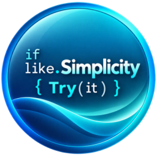
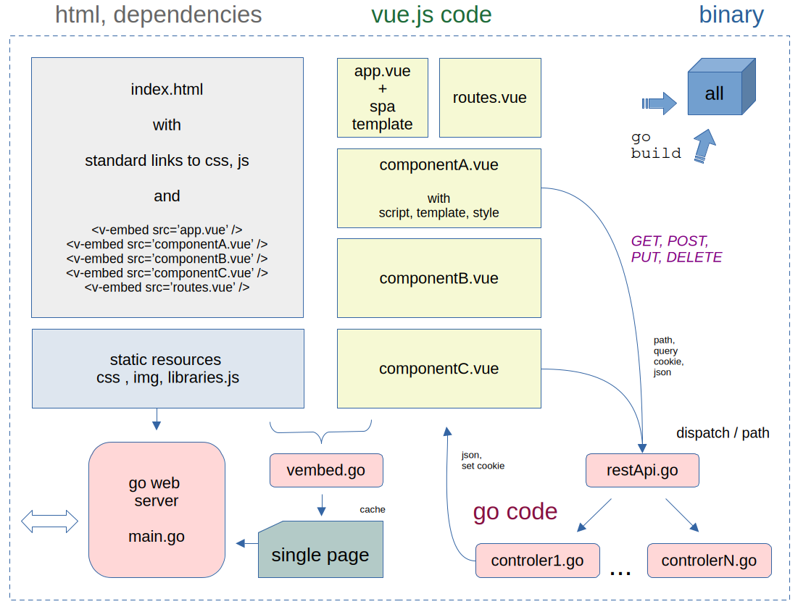

# A  "simple" Solution for Go / Vue.js  integration

|This is an example of __Go__ web application working with __Vue.js__ and __REST Api__ | Main feature |
|---|---|
| - It loads .vue files into a Go project,<br> - It is __SIMPLER__ than Nodejs, Vite.js and others tools,<br> - It uses vue router to dispatch views into single page<br> - It uses a simple REST Api router in Go backend<br> - Simple tooling is included sush as config file, logging and checks &nbsp; &nbsp; &nbsp;  <br> - Simple bootstrap design, alert and confirm js-functions like<br> - Simple REST Api path routing to controlers in Go web server<br> - Ready for dev : debug sources files .vue in browser and Go IDE<br> - Update vue sources without restarting Go : simple refresh<br> - Resources are embed  into binary Go file for production | |

The main the work of integration go/vue is done into __index.html__  and  __vembed.go__ 
- the __index.html__ is your single page , build by yourself,
- __\<v-embed \>__ tag includes vue components ( set of files.vue )

## Architecture



## Build

As a normal Golang application, nothing else.

With static libraries and ressources: 
- check that __cache__ is true in config.yml : to embed all in binary
- CGO_ENABLED=0 go build -o go_vue.bin

Full update of go part
- go get -u all
- go mod tidy

## Dependencies 

* Golang      ( Go Language development )
* Vue 3
* Go Yaml V4

And for this example : 
* Bootstrap css
* Fonts Awesome
* Moment js 
* Axios
* Popper js

## How to 

To add a view or component vue.js

1. Create vue file by copying, or based on model described just below (.vue file format )
2. Adapt the name of component, and name of template : "#ui-home" & \<template id="ui-home"\>
3. Adapt file pathname into : //#sourceURL=http://localhost:8080/vues/home.vue , and  hostname:port 
4. Include it into index.html : \<v-embed src="vues/home.vue"\>\</v-embed\>
5. And others standards things : vue router , rest api to manage this view , etc.

> No import to add at the head of views to use components, but the order of \<v-embed\> is important in case of dependencies on views / components 

> Refer sources to see how are managed vue router and mixins

To add a REST Controler

1. add Route (method,path,controler) into restApi.go : in array routes 
2. add a controller in a new rest/file.go : func controler(w http.ResponseWriter, r *http.Request) 


## Limits

#### Option API 

* Use of Vue.js Option API   ( Composition API  not tested )

#### No style scoped 

* You must prefix component style   .my_style {}  --> .my_comp_my_style to reproduce scope functionnality 

#### No automatic upgrade/Dependencies

* You can use CDN links to include opensource js/css libraries, if on-line environment
* ELSE -> You must copy new version of css/js libraries yourself into "/resources"

> Thus, your external libraries are well controlled   ( exactly what you needs, minimal, light ) 

#### .vue file format

* You must have the  \<script\> part first, then \<template\> and \<style\>
* You must report the filepathname into sourceURL comment to allow browser sources debuggging
* Don't change the emplacement of sourceURL comment, neither 1st line \<script\>

> No need of ContextPath in sourceURL, but hostname:port -> yes

```
<script>
 app.component('ui-home', {
    template : "#ui-home",
    mixins : [ commons ],
    data () { return { ... } }
    methods : 
    ..........
    etc
 }
//# sourceURL=http://localhost:8080/vues/home.vue
</script>

<template id="ui-home">
   ..........
</template>

<style>
  ...........
</style>
```

## Standard alternative

* Use nodejs, npm, vite.js, node_modules --> heavy, learning curve++
* npm run dev  and  build --> 2 process to manage, dist packaging , some differences dev / prod,  some difficulties 
* go:embed  dist/*   files into go binary for production

> This is better for complex GUI, with a lot of dependencies
